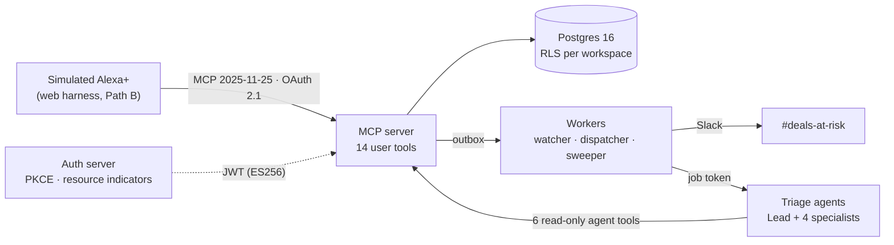

# Watchfloor

**Ambient pipeline-risk triage for Alexa+.** Ask "what needs my attention today?" and Watchfloor
answers in a few seconds. It names the deals at risk, says why with evidence from the CRM, and
proposes the next step. Nothing changes until you confirm it by voice.

Watchfloor is a remote MCP server (protocol **2025-11-25**) built for Alexa+ to call as a tool provider.
Standing orders ("tell the team in Slack when a deal over $50K goes quiet for five days") run in
the background, and a deep-triage agent team reviews a deal on request.

**Path B.** The Alexa+ add-on toolkit was closed to our AWS account
([friction log entry 4](docs/friction-log.md)), so this entry is a simulated Alexa+ experience, as
the hackathon rules allow. The web harness (`services/harness`) is the MCP client. It signs in with
real OAuth and calls the same deployed server over the real protocol. The add-on side (service token,
listing, account linking) is built and ready if access opens ([ADR-024](docs/adr/0024-alexa-service-token.md)).

> Demo video: _coming with the recording on Oct 21._ · Specs: [PRD](docs/PRD.md) ·
> [Design](docs/DESIGN.md) · [Technical](docs/TECHNICAL.md) · [ADRs](docs/adr/)

## Try it

> **Status, 2026-10-17: the hosted dev environment is down.** AWS has blocked all compute on the
> account (Lambda from 2026-10-16, then Fargate; EC2, App Runner, AgentCore and Lightsail are
> refused too, [friction log entry 11](docs/friction-log.md)), so the links below answer with
> errors until AWS Support lifts it. Everything works the same on your machine: see
> [Run it locally](#run-it-locally) and open <http://localhost:8082>.

1. Open the hosted harness at <https://rgroug1dvd.execute-api.us-east-1.amazonaws.com/> and select
   **Sign in**. That runs the real OAuth flow (PKCE) against Watchfloor's auth server.
2. Sign in as `priya@lumenridge.example`. The password is in the Devpost testing instructions; it is
   never in this repository.
3. Pick a suggestion or ask in your own words: "What needs my attention today?", "Why is Kestrel
   at risk?", "Dig into Kestrel", then "Is the Kestrel review finished?". To act, tap a deal on
   the board and **Propose**, or say "Post a heads-up about Kestrel to the team", then "yes";
   "undo" takes it back. "Tell me when a deal over $50K goes quiet for five days" sets a standing
   order. The mic button uses the browser's speech recognition (Chrome or Edge); typing works
   everywhere.

Every tool call, with its latency, is listed beside the conversation. If the language model is
unavailable or out of quota, a keyword router answers the briefing, explain, review and
standing-order questions, and the board's buttons still act; free-form requests to act or to set
an order need the model. The data is a synthetic sales team (Lumenridge) and its deals, so nothing
you do reaches a real customer.
[Privacy](https://b4sp3enfx6.execute-api.us-east-1.amazonaws.com/privacy) ·
[Terms](https://b4sp3enfx6.execute-api.us-east-1.amazonaws.com/terms)

## How it works



- **The voice path never waits on a model.** Risk is scored ahead of time by RIGS, an explainable
  heuristic: Responsiveness, Intent, Governance, Schedule. So every tool answers from Postgres
  (ADR-002, ADR-010).
- **Writes take two steps.** `propose_action` returns a preview and a single-use token, and
  `confirm_action` executes it (ADR-003).
- **Side effects go through a transactional outbox.** Slack posts, drafts and triage jobs are
  committed with the business write and delivered at least once (ADR-008).
- **The agents read only through MCP.** They use a job-scoped token and read-only tools. A
  deterministic gate checks every claim's evidence, every named person and every action against the
  playbook before anything leaves the agent (ADR-007, ADR-012).

### Tools

| For Alexa+ (user scope) | For the triage agents (job scope) |
|---|---|
| `get_risk_briefing` · `explain_deal_risk` · `lookup_deal` | `explain_deal_risk` · `get_deal_timeline` · `get_deal_history` |
| `start_deep_triage` · `get_triage_result` | `get_account_context` · `get_prior_triage` · `get_playbook` |
| `propose_action` · `confirm_action` · `undo_action` · `extend_preview` | |
| `log_deal_update` · `update_briefing_preferences` | |
| `set_standing_order` · `list_standing_orders` · `remove_standing_order` | |

The exact schemas are pinned in
[`services/mcp_server/schemas/tools.snapshot.json`](services/mcp_server/schemas/tools.snapshot.json).

## Repository

| Path | What |
|---|---|
| `packages/core` | Shared domain: RIGS scoring, repositories, services, models, playbook |
| `services/mcp_server` | Streamable HTTP MCP server (stateless, JSON responses) |
| `services/auth_server` | Minimal OAuth 2.1 authorization server (RFC 8414 / 9728, PKCE S256) |
| `services/workers` | Watcher (every 15 min), outbox dispatcher, sweeper, canary; on ECS, one service runs all four (ADR-025) |
| `services/agents` | Strands agents on AgentCore Runtime, or in the async stack as a function or a container (ADR-023, ADR-025); its own uv project (ADR-011) |
| `services/harness` | Simulated Alexa+ (Path B): API with real OAuth sign-in, plus a voice-capable web app (Watch, Pipeline, Orders, Activity and Guide pages, a 3D orb and a 3D floor that shows your deals as a skyline, local personalisation; ADR-026; hands-free voice control of every page, with a wake word and spoken confirmations, ADR-027; brand assets in `docs/brand`) |
| `db` | Forward-only migrations and the deterministic seed |
| `infra` | AWS CDK app (Python): eight stacks per environment; its own uv project |
| `scripts` | Dev keys and tokens, demo operations |
| `tests` | Unit, conformance, integration and security suites |
| `docs` | Specs, ADRs, implementation notes, friction log, feature requests |

## Run it locally

You need Python 3.12, [uv](https://docs.astral.sh/uv/), Docker, and `make` (Git Bash works on Windows).

```bash
make bootstrap                  # Python projects (workspace, agents, harness) + both web builds (needs Node)
cp .env.example .env            # local placeholders only
make db-up                      # Postgres 16 on 127.0.0.1:55432
make migrate                    # schema, row-level security, roles
make seed                       # Lumen Ridge workspace: Kestrel 71 · Harbor & Pine 66 · Orbital 58
make dev-keys                   # local ES256 signing key in .secrets/ (gitignored)
WF_DEMO_PASSWORD='choose-12+-chars' make auth-bootstrap   # OAuth clients + demo logins
make dev                        # MCP :8080 · auth :8081 · harness :8082 · agent :8083 · workers
```

Open the harness at http://localhost:8082 (use `localhost`, not `127.0.0.1`: the sign-in callback
sets its cookie there), sign in as a seeded user such as `priya@lumenridge.example` with your
`WF_DEMO_PASSWORD`, and ask "What needs my attention today?". The triage board appears beside the
chat. Tap a deal for its detail, **Dig into it** for a deep review, **Show the plan** once it's done,
then **Propose** and **Approve**. The page is labelled **Simulated Alexa+ experience**; the MCP
server, sign-in, tools and views behind it are the real ones. `make bootstrap` builds both the
harness page and the views (`make ui` rebuilds the views alone).

Then call the server with a local token:

```bash
TOKEN=$(uv run python scripts/dev_token.py)
curl -s http://localhost:8080/mcp \
  -H "Authorization: Bearer $TOKEN" -H "Content-Type: application/json" \
  -H "Accept: application/json, text/event-stream" -H "MCP-Protocol-Version: 2025-11-25" \
  -d '{"jsonrpc":"2.0","id":1,"method":"tools/call","params":{"name":"get_risk_briefing","arguments":{}}}'
```

Without Bedrock model ids, the local agent uses a deterministic offline engine, and its result
event names the engine (ADR-013). In `dev` and `demo` it never stands in for a missing model (that
job ends `misconfigured`); it only finishes a review whose model failed, and the result says
`engine: offline` and "the quick, rule-based review" (ADR-023). Without a Slack webhook, Slack
messages print to the console.

### Demo operations

| Command | Effect |
|---|---|
| `make demo-reset` | Re-seed relative to now and assert the scenario scores (`ENV=dev\|demo`: through the seeder job) |
| `make demo-clock OFFSET=+14h` | Jump the workspace clock to "next morning", then run the watcher (needs `WF_DEMO_MODE=true`) |
| `make demo-clock OFFSET=0` | Back to real time |
| `make demo-watch-now` | One watcher run: fires standing orders now |
| `make demo-status` | Bands, scenario scores, board, pending proposals, jobs, outbox backlog |
| `uv run python scripts/demo.py outbox-retry --id N` | Re-arm a dead outbox row (`--all-dead` for all of them) |

Each takes `ENV=dev|demo` (for the script, `--env`) to act on a deployed environment: the seeder
job resets, sets the clock, reports status and re-arms outbox rows from inside the VPC, and the
watcher job is the watcher run. With `compute: ecs` (the shipped configs, ADR-025) each is a one-off
Fargate task that `scripts/run_task.py` starts and waits for, about a minute longer than a Lambda
invoke; your AWS credentials need what the deploy role grants for it (`ecs:RunTask` and its
companions in `infra/bootstrap/github-deploy-role.yaml`). With `compute: lambda` they invoke
`wf-<env>-seeder` and `wf-<env>-watcher`, which needs `lambda:InvokeFunction` on both.
Offsets take effect only where `demo_mode: true` (`demo`, not `dev`); `demo-clock` warns otherwise.

## Deploy to AWS

Eight CDK stacks per environment (`dev`, `demo`) in `us-east-1`: net, data, auth, mcp, agents, async,
harness, ops. Pushes to `main` deploy `dev`, and `v*.*.*` tags deploy `demo` (`.github/workflows`).

**On an AWS Free plan account** (new accounts since July 2025 start on it), the models are Amazon
Nova, which runs on demand in us-east-1 and is paid from the credits (ADR-022). Nova Lite runs the
harness, the follow-up drafts and the fast specialists. Nova Pro runs the triage Lead. The `demo`
config ships with `models_enabled: true` and `agents_enabled: false`, so everything deploys except the
Agents stack, and `start_deep_triage` answers that deep reviews aren't available. Set
`agents_enabled: true` to deploy AgentCore Runtime as well; on its first run with agents on,
`deploy-dev` creates the image repository, pushes the agents image, then creates the runtime.
`models_enabled: false` switches every model off: drafts use a template and the harness its
offline engine. That is how `dev` runs today: the account's Bedrock inference quotas (on-demand,
cross-Region and global) and its AgentCore quotas are all 0 and not adjustable in Service Quotas,
so a model call can only be throttled. Once AWS Support raises them, set `models_enabled: true`.
Meanwhile `dev` runs Gemini through Strands (ADR-023, `gemini_enabled`): the harness and the drafts try
Bedrock while models are on, then Gemini, then the keyword router or the template. Gemini's key is the
plain-string secret `wf-<env>/models/gemini`, created by hand. `agents_host: lambda` runs the triage
agents as a function in the async stack instead of on AgentCore, on the same chain: a Lead whose
model fails hands the review to the offline engine. That is how `dev` offers deep reviews today.

**Where it runs** (`compute`, ADR-025). Since 2026-10-16 the account refuses every Lambda call, so
the shipped configs set `compute: ecs`: the same packaged bundles run as arm64 Fargate containers
behind the same HTTP APIs (a VPC link and Cloud Map, no load balancer), one service each for the
auth server, the MCP server, the harness, the triage agents and the workers (dispatcher, watcher,
sweeper and canary in one process). The migrator and the seeder are one-off tasks. `compute: lambda`
is the original layout, unchanged, for when AWS lifts the restriction.

**Without a domain** (the shipped configs: `certificate_arn: null`), nothing needs buying. The MCP
and auth servers answer on their API Gateway hosts (`<id>.execute-api.us-east-1.amazonaws.com`) and
the harness on its CloudFront host (`<id>.cloudfront.net`), or, with `cdn: false` as in `dev` today
(ADR-015), on its own API Gateway host. Those hosts exist only once the stacks
do, and never change after that, so `make cdk-deploy` (run by `make deploy` and both deploy
workflows) writes them into the config as `mcp_domain`, `auth_domain` and `harness_domain`: before
deploying, from stacks that already exist, and after a first deploy, which it then repeats so every
service uses them. Commit them when the workflow's notice shows them. With a domain, set the three
host names and `certificate_arn` instead (and `hosted_zone_*` to have CDK create the DNS records).

What `dev` costs, before credits: about $25–30 a month (Postgres `t4g.micro` and its storage, the
NAT instance and its public IPv4 address, about ten secrets, a KMS key, alarms and logs), plus about
$40 for the five Fargate services on `compute: ecs` (0.25 vCPU each at the arm64 rates, and the
private DNS zone). On `compute: lambda` `dev` ships without provisioned concurrency, which would add
about $9, and `demo` keeps it for its latency gate. Deploy one environment at a time on a
credits-only account. The budget in `dev.yaml` e-mails at $15, $25 and $35 of monthly usage, before
credits.

**Before the first deploy**
1. Fill in `infra/config/<env>.yaml`: account, the alert e-mail, the Bedrock model ids (⚠ Verify
   S6), and either nothing for the host names (see above) or three of your own with an ACM certificate
   in `us-east-1` that covers them.
2. `npx aws-cdk@2 bootstrap aws://<account>/us-east-1` once per account.
3. The GitHub OIDC deploy role, once per environment (`CreateOidcProvider=false` for the second):
   ```bash
   aws cloudformation deploy --template-file infra/bootstrap/github-deploy-role.yaml \
     --stack-name wf-dev-github-deploy --capabilities CAPABILITY_NAMED_IAM \
     --parameter-overrides Env=dev CreateOidcProvider=true
   ```
   Its `RoleArn` output is the repository secret `AWS_DEPLOY_ROLE_DEV` (`_DEMO` for demo); add
   `AWS_ACCOUNT_ID` as a repository variable, and GitHub environments named `dev` and `demo` (the
   role trusts only jobs running in them; give `demo` required reviewers).

**First deploy of an environment** (the agent runtime needs its image to exist first)
```bash
make deploy ENV=dev AGENT_RUNTIME=false   # everything except the agent runtime
make agents-image ENV=dev && make agents-push ENV=dev REPO=<RepositoryUri output>
make deploy ENV=dev              # now with the runtime
make migrate-remote ENV=dev      # migrations, then logins for wf_app / wf_auth from their secrets
make seed-remote ENV=dev         # demo workspace, OAuth clients and logins (the seeder job)
```
`seed-remote` is the AWS twin of `make seed` + `make auth-bootstrap`. Every secret it registers is
generated by the Auth stack in Secrets Manager, and none is printed:

| Secret | Holds | Used by |
|---|---|---|
| `wf-<env>/auth/demo-login` | `password` for every seeded user | You, signing in to the harness |
| `wf-<env>/auth/alexa-client` | `client_secret` of `wf-alexa` | The Alexa+ account-linking setup |
| `wf-<env>/auth/dispatcher-client` | `client_secret` of `wf-dispatcher` | The dispatcher, for job tokens |
| `wf-<env>/canary/login` | `email` (`canary_email` in the config) and its own `password` | The canary |

Set `alexa_redirect_uris` in the config once the skill exists, then `make seed-remote ENV=<env>
SEED_EVENT='{"seed": false}'` registers them without touching the data. Pushes to `main` re-seed
`dev`; a `demo` release only re-registers clients and logins, and `make demo-reset ENV=demo`
resets the demo data before a recording.

Two secrets are filled in by hand: `wf-<env>/slack/webhook` (the webhook URL) and, where
`gemini_enabled` is on, `wf-<env>/models/gemini` (a Google AI Studio API key as a plain string;
nothing else creates it, so create it in Secrets Manager). With custom
domains but no hosted zone in the config, point each host name at its stack's `DnsTarget` output.

`make synth ENV=dev` checks the stacks without building anything; `make test-infra` synthesizes both
environments and asserts what the specs pin down (TLS-only Postgres, ES256 KMS key, alias with
provisioned concurrency, queue timeouts, alarms, agent role without database access).

## Testing

```bash
make test          # unit + protocol conformance
make test-all      # everything, including the agents' and the harness's own suites
make lint          # ruff check + format
```

Tests that need the database use a throwaway `watchfloor_test` database on the compose Postgres,
and are skipped, visibly, when it isn't running. The agents suite needs neither Bedrock nor
Postgres: it runs against a fake MCP server with the seeded Harbor & Pine data.

### Against a running stack

These sign in as the canary user, as a real client would (`WF_CANARY_EMAIL` / `WF_CANARY_PASSWORD`
from `.env` locally; the secret `wf-<env>/canary/login` for `ENV=dev|demo`, so the caller needs
`secretsmanager:GetSecretValue` on it). `ENV=local` needs `make dev` running.

```bash
make conformance-remote ENV=dev   # CF-01..15 over HTTPS (CF-04 needs an agent token: unit suite only)
make latency ENV=dev              # p95 ≤ 150 ms, p99 ≤ 300 ms per read tool, paced under 60 calls/min
make evals ENV=dev                # 40 driver + 10 injection deep reviews, DD §22.5 thresholds
uv run locust -f tests/load/locustfile.py --headless --host https://<mcp domain>   # DD §21.3, 7 min
```

`make evals` drives real jobs: each one posts its plan to the environment's Slack channel. Locally
it exercises the offline engine, so it checks the pipeline, not the model. Rebuild the golden set
with `--write-golden` after a seed or RIGS change. The load profile's 20 rps is above the default
rate limits, so raise `rate_limit_user` / `rate_limit_ws` in `infra/config/<env>.yaml` for the
load window. `tests/evals/utterances.csv` is the 30-utterance sheet (DD §22.6), filled in by hand.
On Path B it runs in the harness: type each utterance and record the first tool from the drawer. Tagged releases run conformance, evals and the latency probe
against `demo`, and upload the eval results.

## Status

| Built | In progress |
|---|---|
| Core domain, RIGS, seed · MCP server (14 user tools, 6 agent tools) · OAuth server · workers · triage agents · harness (API + web) · MCP Apps views (board, detail, confirm) · demo operations (local, and dev through the seeder and watcher jobs) · CDK stacks and CI/CD: **dev was deployed** (us-east-1; moved to ECS Fargate when the account began refusing Lambda, ADR-025) and a push to `main` redeploys it, migrates, reseeds and runs remote conformance (CF-01..15, CF-04 aside) against it, but **since 2026-10-16 the account blocks all compute, so dev is down** until AWS Support lifts it (the CI path is unchanged and was last exercised before the block) · latency probe, triage evals, load profile, utterance sheet (run locally) · Path B: the harness is the entry's Alexa+ experience; the add-on side (ADR-024, listing pages and images, TECHNICAL.md §14) is ready if toolkit access opens | Bedrock-backed eval run (the dev account's Bedrock and AgentCore quotas are 0 until AWS Support raises them, so dev runs with `models_enabled: false` and Gemini, ADR-023) · demo environment (not deployed: one environment fits the free credits) · CloudFront and reserved concurrency in dev (waiting on AWS account limits) |

Where the build departs from the specs, and why, is recorded in
[docs/implementation-notes.md](docs/implementation-notes.md). Platform rough edges found along
the way are in the [friction log](docs/friction-log.md).

## License

[Apache License 2.0](LICENSE). The demo data is synthetic; the people and companies in it are made up.
