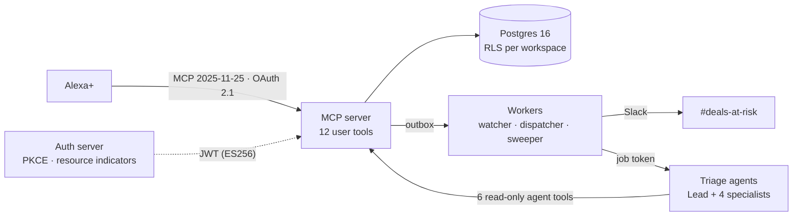

# Watchfloor

**Ambient pipeline-risk triage for Alexa+.** Ask "what needs my attention today?" and Watchfloor
answers in a few seconds. It names the deals at risk, says why with evidence from the CRM, and
proposes the next step. Nothing changes until you confirm it by voice.

Watchfloor is a remote MCP server (protocol **2025-11-25**) that Alexa+ calls as a tool provider.
Standing orders ("tell the team in Slack when a deal over $50K goes quiet for five days") run in
the background, and a deep-triage agent team reviews a deal on request.

> Demo video: _coming with the recording on Oct 21._ · Specs: [PRD](docs/PRD.md) ·
> [Design](docs/DESIGN.md) · [Technical](docs/TECHNICAL.md) · [ADRs](docs/adr/)

## How it works



- **The voice path never waits on a model.** Risk is scored ahead of time by RIGS, an explainable
  heuristic: Responsiveness, Intent, Governance, Schedule. So every tool answers from Postgres
  (ADR-002, ADR-010).
- **Writes take two steps.** `propose_action` returns a preview and a single-use token, and
  `confirm_action` executes it (ADR-003).
- **Side effects go through a transactional outbox.** Slack posts, drafts and triage jobs are
  committed with the business write and delivered at least once (ADR-008).
- **The agents read only through MCP.** They use a job-scoped token and read-only tools. A
  deterministic gate checks every claim's evidence, every named person and every action against the
  playbook before anything leaves the agent (ADR-007, ADR-012).

### Tools

| For Alexa+ (user scope) | For the triage agents (job scope) |
|---|---|
| `get_risk_briefing` · `explain_deal_risk` · `lookup_deal` | `explain_deal_risk` · `get_deal_timeline` · `get_deal_history` |
| `start_deep_triage` · `get_triage_result` | `get_account_context` · `get_prior_triage` · `get_playbook` |
| `propose_action` · `confirm_action` · `log_deal_update` | |
| `set_standing_order` · `list_standing_orders` · `remove_standing_order` | |
| `update_briefing_preferences` | |

The exact schemas are pinned in
[`services/mcp_server/schemas/tools.snapshot.json`](services/mcp_server/schemas/tools.snapshot.json).

## Repository

| Path | What |
|---|---|
| `packages/core` | Shared domain: RIGS scoring, repositories, services, models, playbook |
| `services/mcp_server` | Streamable HTTP MCP server (stateless, JSON responses) |
| `services/auth_server` | Minimal OAuth 2.1 authorization server (RFC 8414 / 9728, PKCE S256) |
| `services/workers` | Watcher (every 15 min), outbox dispatcher, sweeper, canary |
| `services/agents` | Strands agents on AgentCore Runtime; its own uv project (ADR-011) |
| `services/harness` | Simulated Alexa+ (Path B): API with real OAuth sign-in, plus a voice-capable web page |
| `db` | Forward-only migrations and the deterministic seed |
| `scripts` | Dev keys and tokens, demo operations |
| `tests` | Unit, conformance, integration and security suites |
| `docs` | Specs, ADRs, implementation notes, friction log, feature requests |

## Run it locally

You need Python 3.12, [uv](https://docs.astral.sh/uv/), Docker, and `make` (Git Bash works on Windows).

```bash
make bootstrap                  # Python dependencies (workspace + agents project)
cp .env.example .env            # local placeholders only
make db-up                      # Postgres 16 on 127.0.0.1:55432
make migrate                    # schema, row-level security, roles
make seed                       # Lumen Ridge workspace: Kestrel 71 · Harbor & Pine 66 · Orbital 58
make dev-keys                   # local ES256 signing key in .secrets/ (gitignored)
WF_DEMO_PASSWORD='choose-12+-chars' make auth-bootstrap   # OAuth clients + demo logins
make dev                        # MCP :8080 · auth :8081 · harness :8082 · agent :8083 · workers
```

Open the harness at http://localhost:8082 (use `localhost`, not `127.0.0.1`: the sign-in callback
sets its cookie there), sign in as a seeded user such as `priya@lumenridge.example` with your
`WF_DEMO_PASSWORD`, and ask "What needs my attention today?". The triage board appears beside the
chat. Tap a deal for its detail, **Dig into it** for a deep review, **Show the plan** once it's done,
then **Propose** and **Approve**. The page is labelled **Simulated Alexa+ experience**; the MCP
server, sign-in, tools and views behind it are the real ones. `make bootstrap` builds both the
harness page and the views (`make ui` rebuilds the views alone).

Then call the server with a local token:

```bash
TOKEN=$(uv run python scripts/dev_token.py)
curl -s http://localhost:8080/mcp \
  -H "Authorization: Bearer $TOKEN" -H "Content-Type: application/json" \
  -H "Accept: application/json, text/event-stream" -H "MCP-Protocol-Version: 2025-11-25" \
  -d '{"jsonrpc":"2.0","id":1,"method":"tools/call","params":{"name":"get_risk_briefing","arguments":{}}}'
```

Without Bedrock model ids, the local agent uses a deterministic offline engine, and its result
event names the engine (ADR-013). The offline engine never runs in `dev` or `demo`. Without a Slack webhook, Slack messages print to the console.

### Demo operations

| Command | Effect |
|---|---|
| `make demo-reset` | Re-seed relative to now and assert the scenario scores (`ENV=dev\|demo`: through the seeder Lambda) |
| `make demo-clock OFFSET=+14h` | Jump the workspace clock to "next morning", then run the watcher (needs `WF_DEMO_MODE=true`) |
| `make demo-clock OFFSET=0` | Back to real time |
| `make demo-watch-now` | One watcher run: fires standing orders now |
| `make demo-status` | Bands, scenario scores, board, pending proposals, jobs, outbox backlog |
| `uv run python scripts/demo.py outbox-retry --id N` | Re-arm a dead outbox row (`--all-dead` for all of them) |

Each takes `ENV=dev|demo` (for the script, `--env`) to act on a deployed environment: `wf-<env>-seeder`
resets, sets the clock, reports status and re-arms outbox rows from inside the VPC, and
`wf-<env>-watcher` is the watcher run. Your AWS credentials need `lambda:InvokeFunction` on both.
Offsets take effect only where `demo_mode: true` (`demo`, not `dev`); `demo-clock` warns otherwise.

## Deploy to AWS

Eight CDK stacks per environment (`dev`, `demo`) in `us-east-1`: net, data, auth, mcp, agents, async,
harness, ops. Pushes to `main` deploy `dev`, and `v*.*.*` tags deploy `demo` (`.github/workflows`).

**Before the first deploy**
1. Fill in `infra/config/<env>.yaml`: account, the three host names, an ACM certificate in
   `us-east-1` that covers them, the alert e-mail, and the Bedrock model ids (⚠ Verify S6).
2. `npx aws-cdk@2 bootstrap aws://<account>/us-east-1` once per account.
3. The GitHub OIDC deploy role, once per environment (`CreateOidcProvider=false` for the second):
   ```bash
   aws cloudformation deploy --template-file infra/bootstrap/github-deploy-role.yaml      --stack-name wf-dev-github-deploy --capabilities CAPABILITY_NAMED_IAM      --parameter-overrides Env=dev CreateOidcProvider=true
   ```
   Its `RoleArn` output is the repository secret `AWS_DEPLOY_ROLE_DEV` (`_DEMO` for demo); add
   `AWS_ACCOUNT_ID` as a repository variable, and GitHub environments named `dev` and `demo` (the
   role trusts only jobs running in them; give `demo` required reviewers).

**First deploy of an environment** (the agent runtime needs its image to exist first)
```bash
make deploy ENV=dev AGENT_RUNTIME=false   # everything except the agent runtime
make agents-image ENV=dev && make agents-push ENV=dev REPO=<RepositoryUri output>
make deploy ENV=dev              # now with the runtime
make migrate-remote ENV=dev      # migrations, then logins for wf_app / wf_auth from their secrets
make seed-remote ENV=dev         # demo workspace, OAuth clients and logins (the seeder Lambda)
```
`seed-remote` is the AWS twin of `make seed` + `make auth-bootstrap`. Every secret it registers is
generated by the Auth stack in Secrets Manager, and none is printed:

| Secret | Holds | Used by |
|---|---|---|
| `wf-<env>/auth/demo-login` | `password` for every seeded user | You, signing in to the harness |
| `wf-<env>/auth/alexa-client` | `client_secret` of `wf-alexa` | The Alexa+ account-linking setup |
| `wf-<env>/auth/dispatcher-client` | `client_secret` of `wf-dispatcher` | The dispatcher, for job tokens |
| `wf-<env>/canary/login` | `email` (`canary_email` in the config) and its own `password` | The canary |

Set `alexa_redirect_uris` in the config once the skill exists, then `make seed-remote ENV=<env>
SEED_EVENT='{"seed": false}'` registers them without touching the data. Pushes to `main` re-seed
`dev`; a `demo` release only re-registers clients and logins, and `make demo-reset ENV=demo`
resets the demo data before a recording.

The only secret left to fill in by hand is `wf-<env>/slack/webhook` (the webhook URL). Without a
hosted zone in the config, point each host name at its stack's `DnsTarget` output.

`make synth ENV=dev` checks the stacks without building anything; `make test-infra` synthesizes both
environments and asserts what the specs pin down (TLS-only Postgres, ES256 KMS key, alias with
provisioned concurrency, queue timeouts, alarms, agent role without database access).

## Testing

```bash
make test          # unit + protocol conformance
make test-all      # everything, including the agents' and the harness's own suites
make lint          # ruff check + format
```

Tests that need the database use a throwaway `watchfloor_test` database on the compose Postgres,
and are skipped, visibly, when it isn't running. The agents suite needs neither Bedrock nor
Postgres: it runs against a fake MCP server with the seeded Harbor & Pine data.

### Against a running stack

These sign in as the canary user, as a real client would (`WF_CANARY_EMAIL` / `WF_CANARY_PASSWORD`
from `.env` locally; the secret `wf-<env>/canary/login` for `ENV=dev|demo`, so the caller needs
`secretsmanager:GetSecretValue` on it). `ENV=local` needs `make dev` running.

```bash
make conformance-remote ENV=dev   # CF-01..15 over HTTPS (CF-04 needs an agent token: unit suite only)
make latency ENV=dev              # p95 ≤ 150 ms, p99 ≤ 300 ms per read tool, paced under 60 calls/min
make evals ENV=dev                # 40 driver + 10 injection deep reviews, DD §22.5 thresholds
uv run locust -f tests/load/locustfile.py --headless --host https://<mcp domain>   # DD §21.3, 7 min
```

`make evals` drives real jobs: each one posts its plan to the environment's Slack channel. Locally
it exercises the offline engine, so it checks the pipeline, not the model. Rebuild the golden set
with `--write-golden` after a seed or RIGS change. The load profile's 20 rps is above the default
rate limits, so raise `rate_limit_user` / `rate_limit_ws` in `infra/config/<env>.yaml` for the
load window. `tests/evals/utterances.csv` is the 30-utterance sheet for the Alexa+ web simulator
(DD §22.6), filled in by hand. Tagged releases run conformance, evals and the latency probe
against `demo`, and upload the eval results.

## Status

| Built | In progress |
|---|---|
| Core domain, RIGS, seed · MCP server (12 user tools, 6 agent tools) · OAuth server · workers · triage agents · harness (API + web) · MCP Apps views (board, detail, confirm) · demo operations (local, and dev/demo through the seeder and watcher Lambdas) · CDK stacks, seeder and CI/CD workflows (synthesized and tested, not yet deployed) · remote conformance, latency probe, triage evals, load profile, utterance sheet (run locally; not yet against AWS) | First AWS deploy · model-backed eval run · Local Inspector (command unverified) |

Where the build departs from the specs, and why, is recorded in
[docs/implementation-notes.md](docs/implementation-notes.md). Platform rough edges found along
the way are in the [friction log](docs/friction-log.md).
