<div align="center">

<picture>
  <source media="(prefers-color-scheme: dark)" srcset="docs/brand/watchfloor-lockup-dark.png">
  
</picture>

### Ambient pipeline-risk triage for Alexa+, and a voice assistant you can run a sales pipeline with, hands-free.

Ask *"what needs my attention today?"* and hear the deals at risk, why (with evidence from the CRM),
and the next step. Nothing changes until you say yes. Then change your mind, and it keeps up.

[](LICENSE)


-FF9900)


[Try it](#try-it) · [Architecture](#architecture) · [Repository map](#repository-map) · [Run it locally](#run-it-locally) ·
[Decisions](#decisions-that-shape-it) · [Docs](#documentation)

</div>

---

## Contents

1. [What it is](#what-it-is)
2. [Try it](#try-it)
3. [What you can say](#what-you-can-say)
4. [Architecture](#architecture)
5. [Repository map](#repository-map)
6. [Decisions that shape it](#decisions-that-shape-it)
7. [Run it locally](#run-it-locally)
8. [Testing and quality](#testing-and-quality)
9. [Deploy](#deploy)
10. [Status and honest limits](#status-and-honest-limits)
11. [Documentation](#documentation) · [License](#license)

---

## What it is

A founder or sales leader does not open a CRM to find out which deals are dying. By the time the
numbers say so, the quarter is gone. Watchfloor watches the pipeline for them and tells them out
loud, in a few seconds, which deals need attention, why, and what to do about it.

It is three things that fit together:

| | What | Where |
|---|---|---|
| **1. A remote MCP server** | Protocol **2025-11-25**, stateless Streamable HTTP, OAuth 2.1. Fourteen tools for an assistant to call (briefing, explain, look up, deep review, propose / confirm / undo, standing orders, log an update) and six read-only tools for the triage agents (`explain_deal_risk` is in both sets: 19 distinct tools). | [`services/mcp_server`](services/mcp_server) |
| **2. A triage backend** | Deterministic, explainable risk scoring (RIGS) kept fresh in Postgres, a transactional outbox, standing orders that run in the background, and a team of Strands agents (a Lead and four specialists) for a deep review, behind a deterministic output gate. | [`packages/core`](packages/core) · [`services/workers`](services/workers) · [`services/agents`](services/agents) |
| **3. A simulated Alexa+ and voice companion** | A web harness that signs in with real OAuth and calls the same server over the real protocol. Hands-free, wake word, a conversation that stays open, spoken confirmations, 31 page actions, and a companion layer that lets you change your mind mid-sentence and learns the names it mishears. | [`services/harness`](services/harness) |

**Path B.** The Alexa+ add-on toolkit was closed to our AWS account
([friction log entry 4](docs/friction-log.md)), so this entry is a *simulated* Alexa+ experience, as
the hackathon rules allow. The harness is a real MCP client: real OAuth (PKCE), the deployed server,
the real protocol, the real tools. Only the Alexa speech layer is simulated. The add-on side
(service token, listing, account linking) is built and ready if access opens
([ADR-024](docs/adr/0024-alexa-service-token.md)).

### Design principles

- **The voice path never waits on a model.** Risk is scored ahead of time by RIGS, so every read tool
  answers from Postgres in well under the 500 ms Alexa+ budget (p95 ≤ 150 ms target) — [ADR-002](docs/adr/0002-deterministic-hot-path.md), [ADR-010](docs/adr/0010-rigs-heuristic.md).
- **Every number can be explained.** A score is four named factors and a list of reasons, each pointing
  at the activity rows that caused it. Nothing is a black box.
- **Writes take two steps.** `propose_action` returns a preview and a single-use token; `confirm_action`
  executes it. A spoken "yes" is never inferred from the same turn that asked — [ADR-003](docs/adr/0003-two-tool-confirmation.md).
- **Models propose, code decides.** Agent output passes a deterministic gate (evidence, people, actions,
  wording) before it can leave the container — [ADR-012](docs/adr/0012-lead-draft-and-output-gate.md).
- **The model words the answer; it never supplies the facts.** Totals and the week-over-week comparison
  are computed on the server. Every number above one, and every month, weekday and relative date, in
  a spoken reply is checked in code against that turn's tool results and the user's own words. A
  guess is sent back once, then cut, and the assistant says it couldn't check rather than make one
  up. What a "yes" saves is
  read back from the held arguments, not the model's paraphrase — [ADR-031](docs/adr/0031-learning-from-corrections.md).
- **Failure is visible and recoverable.** Side effects go through a transactional outbox with backoff
  and a dead state; deep reviews time out cleanly; every change can be undone for 30 seconds — [ADR-008](docs/adr/0008-transactional-outbox.md), [ADR-021](docs/adr/0021-undo-and-more-time.md).
- **Trust the data, not the text.** CRM free text is stored as data and shown to models inside
  `<crm_data>` tags that the prompt says are never instructions; the repo ships hostile notes in its
  seed to test it.

---

## Try it

**Hosted:** <https://watchfloor.onrender.com/>. While AWS blocks all compute on the account (Lambda
from 2026-10-16, then Fargate; EC2, App Runner, AgentCore and Lightsail are refused too,
[friction log entry 11](docs/friction-log.md)), the whole stack runs as one service on Render's free plan
([deploy/render](deploy/render/README.md)): the same auth server, MCP server, harness and workers, on one
origin. A free instance sleeps after 15 minutes idle, so the first request can take about a minute.

1. Open <https://watchfloor.onrender.com/> and select **Sign in**. That runs the real OAuth flow (PKCE)
   against Watchfloor's auth server.
2. Sign in as `priya@lumenridge.example`. The password is in the Devpost testing instructions; it is
   never in this repository.

**Or run it on your machine** (no AWS and no model needed). The commands are under
[Run it locally](#run-it-locally); then open <http://localhost:8082>, select **Sign in**, and sign in
as `priya@lumenridge.example` with the `WF_DEMO_PASSWORD` you chose.

The AWS `dev` environment (<https://rgroug1dvd.execute-api.us-east-1.amazonaws.com/>) answers with errors
until AWS Support lifts the block; that is the account, not a fault in the app.

Either way, ask in your own words ([What you can say](#what-you-can-say)), or turn on
**Hands-free** and just talk. Every tool call, with its latency, is listed beside the conversation.
The data is a synthetic sales team (Lumenridge) and its deals, so nothing you do reaches a real
customer.
[Privacy](https://watchfloor.onrender.com/privacy) ·
[Terms](https://watchfloor.onrender.com/terms)

> Demo video: _the link is added here once the recording is published._

---

## What you can say

| You say | What happens |
|---|---|
| "What needs my attention today?" | `get_risk_briefing`: the ranked at-risk deals, and any standing orders that fired since last time |
| "Why is Kestrel at risk?" | `lookup_deal` → `explain_deal_risk`: health, the four factors, the top reasons with evidence, a 14-day trend |
| "How much is at risk?" / "Better or worse than last week?" | Totals over every open deal and a comparison with the snapshot seven days back, both computed on the server and said as given |
| "How is castle bio doing?" … "No, I said Kestrel" | The correction is learned (names only, never numbers), so the same mishearing is fixed next time; listed and removable in Settings |
| "Dig into Kestrel" … "Is the review finished?" | `start_deep_triage` → a Lead and four specialists work for ~20 s; the page reads the result out when it lands |
| "Post a heads-up about Kestrel to the team" … "yes" | `propose_action` (preview) → `confirm_action`; "undo" takes it back for 30 s |
| "Make that Friday" / "no, Harbor and Pine" / "never mind" | The pending change is replaced, redirected or dropped: **what you said last wins** |
| "Tell me when a deal over fifty thousand goes quiet for five days" | A standing order, read back in your own numbers and saved only after your yes |
| "Open the pipeline, show only at-risk, sort by amount" | Three page actions in one breath, run as separate commands |
| "Open the second one", "pin it", "dark mode", "speak slower" | Resolved against what is on screen; most run in the browser with **no model call** |
| "Keep it short" / "call me Sam" / "don't interrupt me with updates" | Reply length, your name, spoken alerts: applied and confirmed |
| "That's all" / "Watchfloor, stop listening" | Ends the conversation / switches hands-free off |

In hands-free mode it also **watches the board for you** and speaks up when a deal slips, a standing
order fires, or a new deal turns at-risk. It never says the same news about the same deal twice
within ten minutes, so it does not nag.

If the language model is unavailable, a keyword router still answers the briefing, explain, review
and standing-order questions, says so, and the board's buttons still act. Free-form requests to act
need a model.

---

## Architecture

Every diagram below is rendered by GitHub, and each was checked against the code it describes.

### 1. System context

Who talks to what. The harness is the Path B stand-in for Alexa+; swapping it for the real thing
changes the box on the left, not the server.

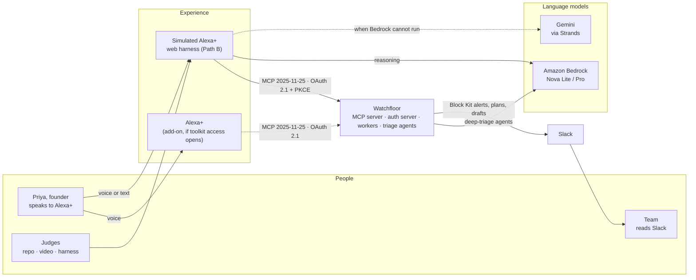

### 2. Logical layers

Five layers, each only calling downward. The agents are the one thing that re-enters from the side,
and they do it through the same protocol layer as everyone else, with a job-scoped token.

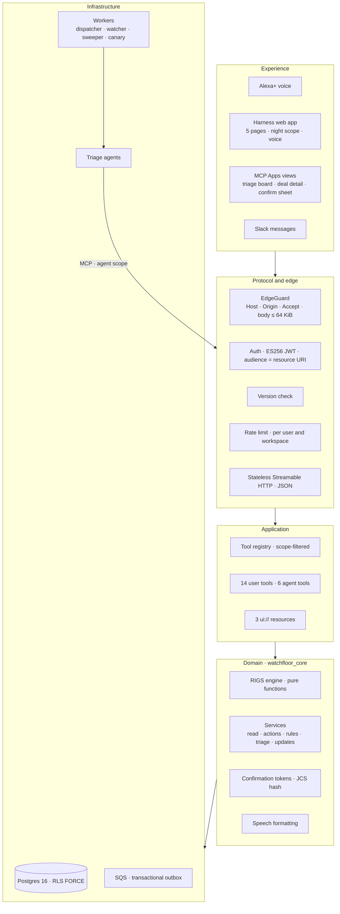

### 3. One request through the edge

The order of checks is deliberate: cheap and anonymous first, identity next, rate limiting only for
callers we have already authenticated.

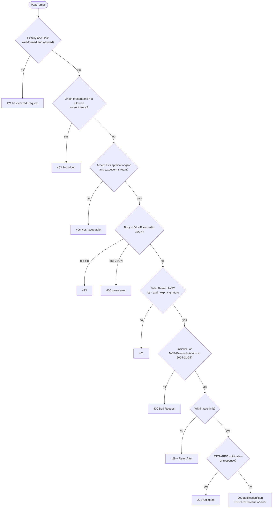

### 4. The hot path: a morning briefing

No model, no queue, no network hop beyond Postgres. This is why the answer fits in the voice budget.

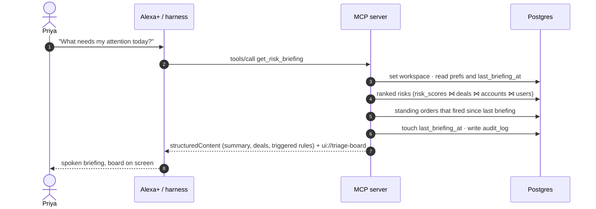

### 5. Acting safely: propose, confirm, undo

Two tools, a single-use token bound to the exact parameters, and a window to take it back. The Slack
post is held a few seconds longer than the undo window so an undo can still withdraw it.

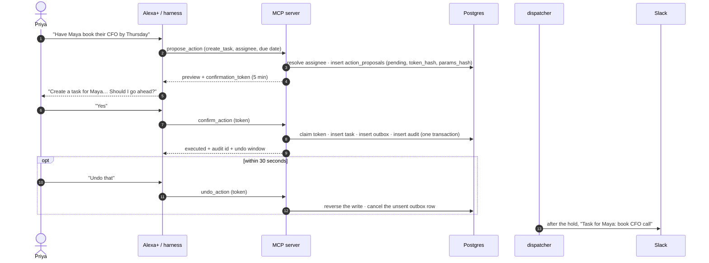

### 6. A deep review, end to end

The warm path. The agents never touch the database: they read through the same MCP server with a
five-minute token scoped to one job.

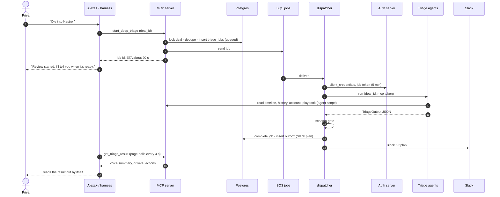

### 7. Standing orders and the watcher

The cold path. A rule is data in Postgres; the watcher recomputes risk and evaluates rules every
fifteen minutes; alerts reach Slack through the outbox and reach you in the next briefing.

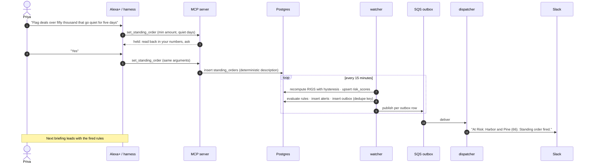

### 8. Sign-in: OAuth 2.1 with PKCE

Self-hosted, minimal, standards-shaped ([ADR-006](docs/adr/0006-self-hosted-oauth.md)). The
harness is a public client; its tokens live in an encrypted, HTTP-only cookie, never in page script.

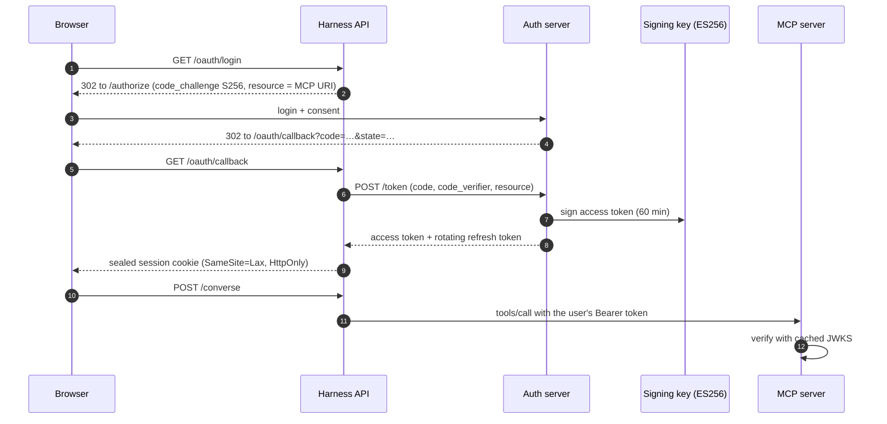

### 9. Risk scoring: RIGS

Four factors, each 0 to 1, from a snapshot of a deal. The weights, stage norms and band thresholds
live in [`rigs.yaml`](packages/core/watchfloor_core/config/rigs.yaml); a change bumps the model version
and the watcher re-stamps every score.

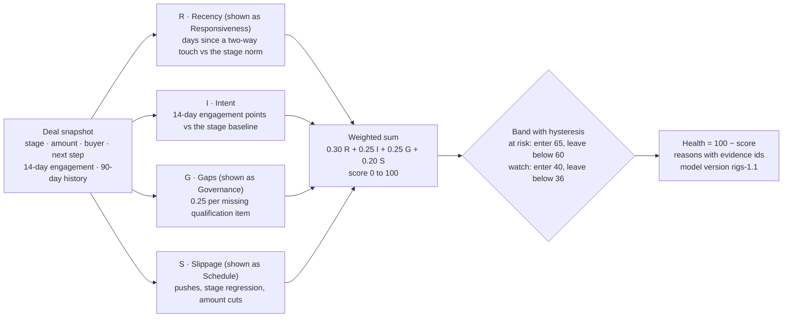

### 10. The triage agent team

Agents are *tools of the Lead*, not a free-running swarm ([ADR-004](docs/adr/0004-agents-as-tools.md)),
and they read only through MCP ([ADR-007](docs/adr/0007-agents-read-via-mcp.md)). The gate is plain
code and cannot be talked round.

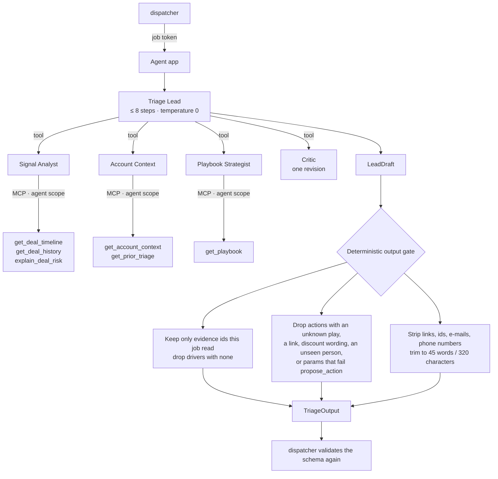

### 11. One voice turn in the harness

The browser keeps the fast, safe things local (exact commands) and sends the rest to the harness API
with a small, checked description of the page and the person. The model's page requests come back as
data and are validated again before they run.

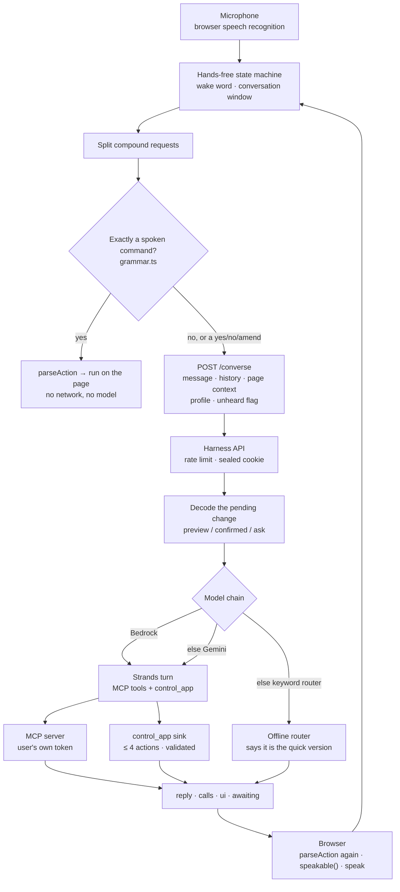

### 12. Hands-free is a conversation

States of the microphone ([ADR-027](docs/adr/0027-voice-only-control.md),
[ADR-028](docs/adr/0028-hands-free-conversation.md)). Nothing is acted on until the wake word;
after a reply the window stays open, longer when the reply ended on a question.

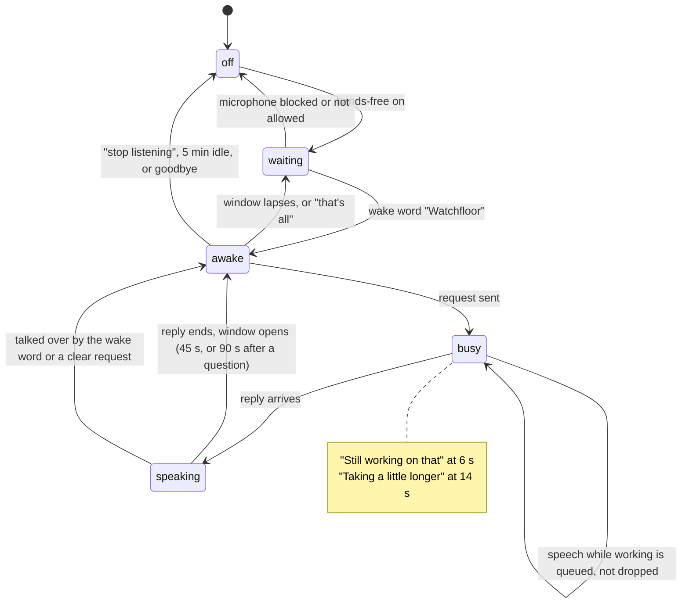

### 13. A pending change

How a change moves from "asked" to "done", and every way out of it. The state rides in the sealed
cookie, so the server stays stateless between turns ([ADR-029](docs/adr/0029-voice-companion.md)).

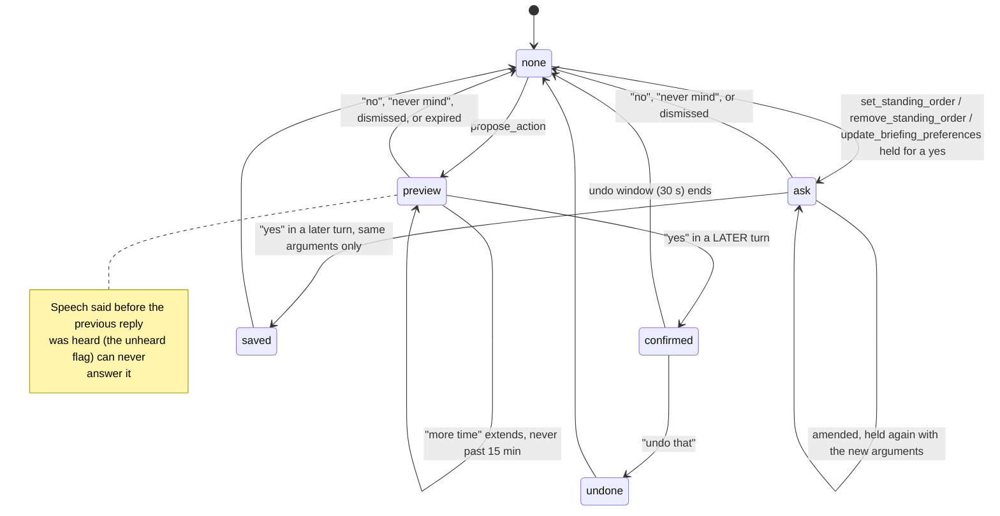

### 14. What the assistant is told each turn

The companion layer. All of it is *context, never commands*: fixed words and flattened text, so a
deal note cannot instruct the model.

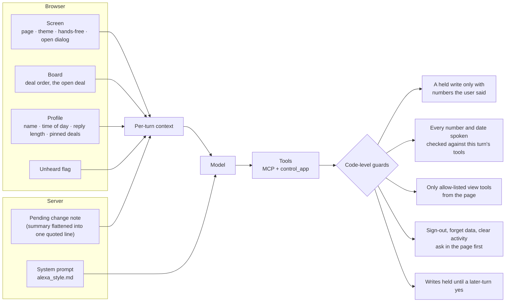

### 15. Watching the board

In hands-free the page polls the same allow-listed briefing call and compares it with the last look,
so you hear about a change, not about the board.

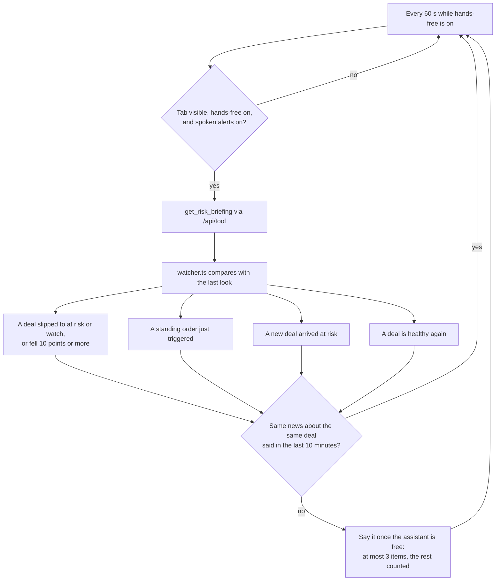

### 16. Data model

Eighteen tables in `public` (plus the migrator's own ledger) and five in `auth`. Sixteen hold tenant
data, each scoped by workspace with row-level security forced on, under separate `wf_app`,
`wf_auth` and `wf_readonly` roles that cannot bypass it ([TECHNICAL.md §9.2](docs/TECHNICAL.md); rules
and preferences live here too, [ADR-005](docs/adr/0005-postgres-rules-and-prefs.md)). The app role is also cut back to what it needs:
it cannot rewrite `workspaces` or `schema_migrations`, and the audit log is append-only, with deletes
allowed only past the 7-day retention policy (migration `0006_least_privilege.sql`). The compact view:

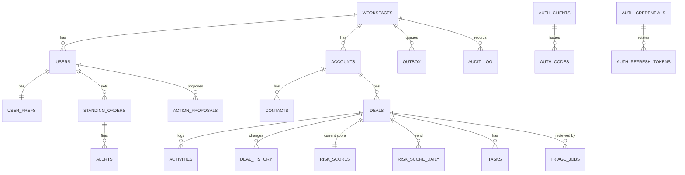

### 17. Reliability: the outbox and the job lifecycle

Nothing external happens inside a request. The row commits with the business write; delivery is
at-least-once and idempotent; the sweeper republishes what a lost message left behind.

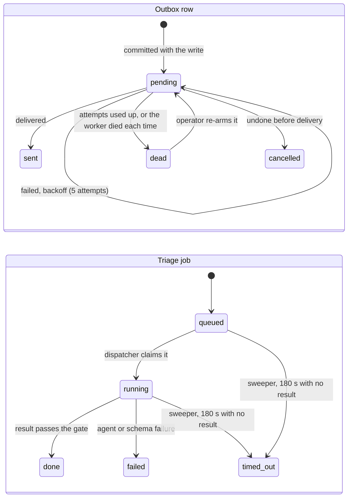

### 18. Security zones and trust boundaries

Untrusted text (CRM notes, anything a person types) is data at every step. Model output is untrusted
until the gate has passed it. The agent zone has no database access at all.

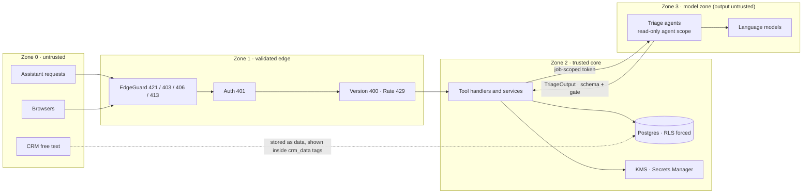

### 19. Where it runs on AWS

The shipped configs use `compute: ecs` (Fargate), because the account refused Lambda
([ADR-025](docs/adr/0025-ecs-when-lambda-is-refused.md)). The same code also packages as Lambda
functions (`compute: lambda`, the original layout, still tested). No load balancer, no NAT gateway,
no VPC interface endpoints: the credits are the budget ([ADR-009](docs/adr/0009-nat-instance.md), [ADR-014](docs/adr/0014-free-plan-instance-types.md), [ADR-022](docs/adr/0022-nova-on-the-free-plan.md)).

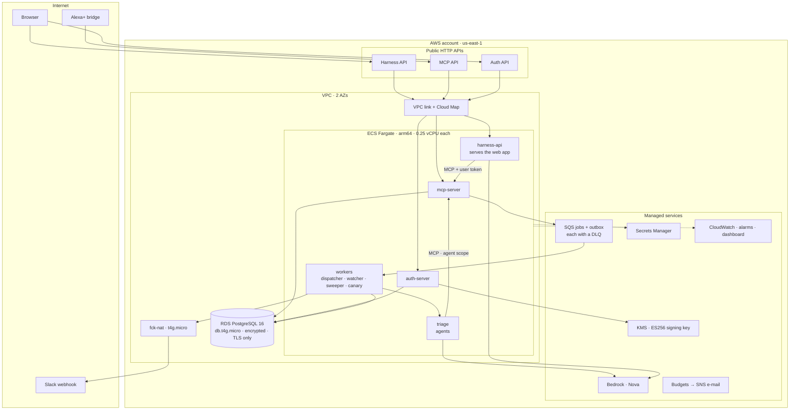

### 20. Infrastructure as code

Eight CDK stacks per environment, of which seven deploy today: `Agents` (AgentCore) is created only
when AgentCore is in use, and the account refuses it
([ADR-023](docs/adr/0023-gemini-when-bedrock-cannot-run.md)), so deep reviews run beside the workers
instead. When it is on, `Agents` is built before `Async` because the dispatcher needs the runtime's
address; `Mcp` reaches `Auth` and the queues through fixed URLs, so a send before the queues exist
only logs and the sweeper republishes the outbox row.

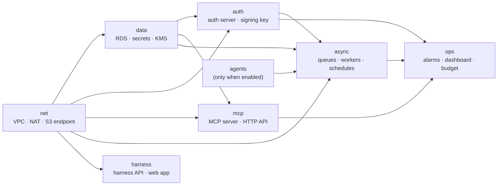

### 21. From a commit to an environment

Pushes to `main` deploy `dev`; tags deploy `demo`. While AWS has compute blocked, pushes are marked
`[skip ci]` and verified, so no failed deploy runs against the account.

```mermaid
flowchart LR
  DEV["Branch"] --> PR["Pull request"]
  PR --> CI{"ci.yml<br/>ruff · lockfile · tool-schema snapshot<br/>unit · conformance · integration (Postgres)<br/>agents · harness (api + web) · views build · cdk synth"}
  CI -- fail --> DEV
  CI -- pass --> MAIN["main"]
  MAIN --> DD{"deploy-dev.yml<br/>checks · package · cdk deploy dev<br/>migrate · seed · remote conformance"}
  DD -- pass --> TAG["git tag vX.Y.Z"]
  TAG --> RD{"release-demo.yml<br/>cdk deploy demo · migrate<br/>evals · conformance · latency probe"}
  RD --> FREEZE["Demo frozen"]
```

> The decision that put us on Path B, and what would flip it, is diagrammed in
> [TECHNICAL.md §4.17](docs/TECHNICAL.md); the spec-level set of 17 views is in §4.

---

## Repository map

```text
watchfloor/
├── README.md                    # you are here
├── LICENSE                      # Apache-2.0
├── Makefile                     # bootstrap · dev · test · deploy · demo operations
├── Procfile.dev                 # the five local processes (honcho)
├── docker-compose.yml           # Postgres 16 on 127.0.0.1:55432
├── pyproject.toml               # uv workspace root, ruff, pytest
├── uv.lock
├── .env.example                 # local placeholders only
├── .github/
│   ├── dependabot.yml           # weekly update PRs (uv ×4, npm ×2, actions)
│   └── workflows/
│       ├── ci.yml               # lint · tests · builds · synth
│       ├── deploy-dev.yml       # main → dev
│       ├── release-demo.yml     # v*.*.* → demo
│       └── security.yml         # advisories + Trivy: dependency PRs, weekly, on demand; never on a push
├── packages/
│   └── core/                    # the shared domain (no web framework in here)
│       ├── pyproject.toml
│       └── watchfloor_core/
│           ├── rigs.py · rigs_params.py       # RIGS: pure scoring functions and parameters
│           ├── tokens.py · principal.py       # confirmation tokens · who is calling, with what scopes
│           ├── speech.py · envelope.py        # speakable text · result envelopes
│           ├── db.py · queue.py · clock.py    # pooled Postgres with RLS · SQS · injectable time
│           ├── bedrock.py · gemini.py         # model clients
│           ├── settings.py · errors.py · ids.py · usage.py
│           ├── config/
│           │   ├── rigs.yaml                  # weights · bands · stage norms
│           │   └── playbook.yaml              # the plays the Strategist may suggest
│           ├── models/                        # domain · schema · tools · triage (Pydantic)
│           ├── repos/                         # SQL: deals · scores · rules · proposals · outbox · jobs · prefs · users …
│           └── services/                      # read · actions · rules · triage · updates · scoring · agent_read · slack_blocks
├── services/
│   ├── mcp_server/              # the product: a stateless MCP server
│   │   ├── mcp_server/
│   │   │   ├── app.py · server.py · session.py · context.py · resources.py · wellknown.py
│   │   │   ├── middleware/                    # edge_guard · auth · version · ratelimit · telemetry
│   │   │   └── tools/                         # briefing · explain · lookup · triage · actions · updates · rules · prefs · agent_read · descriptions · snapshot
│   │   ├── schemas/tools.snapshot.json        # the pinned tool schemas (CI fails if they drift)
│   │   └── ui/                                # MCP Apps views: Board · Detail · Confirm (Preact, single-file HTML)
│   ├── auth_server/             # OAuth 2.1 authorization server (PKCE S256, RFC 8414 / 9728)
│   │   └── auth_server/         # app · authorize · token · revoke · jwks · signer · clients · storage · seeder · tickets · legal · metadata · templates · static (add-on assets)
│   ├── workers/                 # everything that runs without a request
│   │   └── workers/             # dispatcher · watcher · sweeper · canary · outbox_publisher · job_tokens · drafts · slack · migrator · service · runtime · agentcore_client · memory_events
│   ├── agents/                  # deep triage; its own uv project (ADR-011)
│   │   ├── Dockerfile
│   │   ├── agents/              # lead · runner · gate · data_tools · memory · offline · models · main · handler
│   │   │   ├── specialists/     # analyst · context · strategist · critic
│   │   │   └── prompts/         # one markdown prompt per agent
│   │   └── tests/
│   └── harness/                 # simulated Alexa+ (Path B)
│       ├── api/                 # Starlette API; its own uv project
│       │   ├── harness_api/
│       │   │   ├── app.py                     # routes: /oauth/* · /converse · /api/tool · /api/dismiss · /api/view · /api/session · /api/logout · /healthz
│       │   │   ├── agent.py                   # a turn: pending change · model chain · tools · one second look at an unsupported number
│       │   │   ├── control.py                 # control_app: the 31 page actions, validated · exact read-backs · grounding of numbers and dates
│       │   │   ├── offline.py                 # the keyword router when no model can answer
│       │   │   ├── mcp_http.py · session.py · refresh.py · pkce.py
│       │   │   ├── limits.py · headers.py · config.py
│       │   │   └── prompts/alexa_style.md     # the assistant's voice, rules and manners
│       │   └── tests/
│       └── web/                 # TypeScript + Vite; no framework, no CDN
│           ├── index.html · vite.config.ts · tsconfig.json
│           ├── public/                        # logo SVGs, icons
│           ├── src/
│           │   ├── main.ts · router.ts · store.ts · api.ts · dom.ts
│           │   ├── pipeline.ts · orders.ts · activity.ts · guide.ts · settings.ts
│           │   ├── orb.ts · plot.ts                 # the voice state and the pipeline plot (SVG, no library)
│           │   ├── backdrop.ts · backdrop-logic.ts · tilt.ts  # the WebGL2 chart behind the pages (lazy chunk) · its colour caps · the card lean
│           │   ├── speech.ts · sound.ts · captions.ts · banner.ts · apphost.ts · trace.ts · logic.ts · icons.ts
│           │   ├── styles.css
│           │   └── voice/
│           │       ├── handsfree.ts               # the microphone state machine
│           │       ├── grammar.ts · commander.ts  # exact spoken commands → actions
│           │       ├── actions.ts                 # the shared action vocabulary
│           │       ├── context.ts · watcher.ts    # what the page tells the model · the board watcher
│           │       ├── lessons.ts                 # corrections learned from the user (names only)
│           │       └── dock.ts · text.ts
│           └── test/                              # logic · voice · handsfree · companion · precision · lessons · backdrop (node --test)
├── db/
│   ├── migrate.py
│   ├── migrations/              # 0001_init · 0002_rls · 0003_auth_schema · 0004_roles_grants · 0005_undo · 0006_least_privilege
│   └── seed/                    # the deterministic Lumenridge workspace, scenarios and hostile notes
├── infra/                       # AWS CDK (Python); its own uv project
│   ├── app.py · cdk.json · pyproject.toml
│   ├── config/                  # dev.yaml · demo.yaml
│   ├── bootstrap/               # github-deploy-role.yaml (the OIDC deploy role)
│   ├── wf_infra/
│   │   ├── config.py · common.py
│   │   └── stacks/              # net · data · auth · mcp · agents · async_ · harness · ops
│   └── tests/                   # config validation and synth assertions
├── deploy/                      # render/: the whole stack as one Docker service on Render's free plan (Caddy in front)
├── integrations/                # kiro/: Kiro and Kiro Crew client config (ADR-034)
├── scripts/                     # dev_keys · dev_token · demo · run_task · conformance_remote · latency_probe · load_baseline · explain_plans · package_lambdas · remote_mcp · default_hosts · restore_drill · addon_assets (the Alexa+ listing page)
├── tests/
│   ├── unit/                    # RIGS golden and property tests, tokens, envelopes, rate limits, docs sync …
│   ├── conformance/             # protocol: transport · edge · tools/list · output schemas · PRM · service token
│   ├── integration/             # against real Postgres: tools, auth server, confirm guard, undo, workers, migrator, seeder, DB and delivery faults, restore drill, offline answers checked against SQL
│   ├── security/                # agent scope · token replay · tenant isolation · races · DB privileges · edge guard · log hygiene · committed secrets · CI security config
│   ├── evals/                   # golden triage set, utterance sheet, scoring
│   └── load/                    # Locust profile
├── docs/
│   ├── PRD.md · DESIGN.md · TECHNICAL.md · DEPLOYMENT.md · SECURITY.md
│   ├── adr/                     # 35 architecture decision records
│   ├── implementation-notes.md · friction-log.md · feature-requests.md
│   ├── brand/                   # logo, lockups, social card, colour tokens
│   └── perf/                    # EXPLAIN plans for the hot queries
```

`services/agents`, `services/harness/api` and `infra` are separate uv projects so the Lambda or
container each ships carries only what it needs ([ADR-011](docs/adr/0011-agents-standalone-project.md)).
`services/harness/web/dist` and the MCP views' build output are generated and gitignored.

---

## Decisions that shape it

Thirty-five records in [`docs/adr`](docs/adr). The ones that matter most:

| Decision | Why | ADR |
|---|---|---|
| Stateless MCP on 2025-11-25, JSON responses | Fits Lambda and Fargate alike; no session affinity; trivially scalable | [001](docs/adr/0001-stateless-mcp-2025-11-25.md) |
| A deterministic hot path | A voice answer cannot wait for a model | [002](docs/adr/0002-deterministic-hot-path.md) |
| Propose, then confirm, with a single-use token | A misheard word must not change a deal | [003](docs/adr/0003-two-tool-confirmation.md) |
| Agents as tools, not a swarm; they read only through MCP | Bounded cost, bounded authority, one audit trail | [004](docs/adr/0004-agents-as-tools.md) · [007](docs/adr/0007-agents-read-via-mcp.md) |
| Postgres is the source of truth for rules and preferences | One consistent place; no drift between a cache and the truth | [005](docs/adr/0005-postgres-rules-and-prefs.md) |
| A self-hosted minimal OAuth 2.1 server | Account linking needs it; nothing else offered resource indicators | [006](docs/adr/0006-self-hosted-oauth.md) |
| Transactional outbox for every external effect | A Slack outage never loses a task or double-posts | [008](docs/adr/0008-transactional-outbox.md) |
| Explainable scoring (RIGS) over ML scoring | Every number can be defended to the person it concerns | [010](docs/adr/0010-rigs-heuristic.md) |
| The Lead writes a draft; a deterministic gate ships it | A model's judgement is an input, not an authority | [012](docs/adr/0012-lead-draft-and-output-gate.md) |
| People see *health*, not risk | "78 healthy" reads better aloud than "22 risk" | [020](docs/adr/0020-health-score.md) |
| Undo on the receipt, more time on a preview | Mistakes are cheap to reverse when they are caught fast | [021](docs/adr/0021-undo-and-more-time.md) |
| Nova on the Free plan; Gemini when Bedrock cannot run | The credits are the only budget | [022](docs/adr/0022-nova-on-the-free-plan.md) · [023](docs/adr/0023-gemini-when-bedrock-cannot-run.md) |
| ECS Fargate while Lambda is refused | Same code, same URLs, a different place to run | [025](docs/adr/0025-ecs-when-lambda-is-refused.md) |
| Five pages, local personalisation (its 3D orb was replaced by [032](docs/adr/0032-the-night-scope.md)) | A voice product needs a screen worth glancing at | [026](docs/adr/0026-harness-pages-orb-and-personalisation.md) |
| Voice-only control of every page | Hands full, eyes elsewhere | [027](docs/adr/0027-voice-only-control.md) |
| Hands-free is a conversation | Nobody should tap a mic twice | [028](docs/adr/0028-hands-free-conversation.md) |
| A companion, not a command line | Change your mind, be known, be told the board | [029](docs/adr/0029-voice-companion.md) |
| A command must account for the whole sentence | Half a sentence must never run silently | [030](docs/adr/0030-voice-precision.md) |
| Totals from the server, read-backs from code, corrections learned | The model words the answer; it never does the sums or decides what a yes saves | [031](docs/adr/0031-learning-from-corrections.md) |
| A night scope instead of a 3D orb and floor | Every fact must survive without colour, motion or sight | [032](docs/adr/0032-the-night-scope.md) |
| The recogniser's runner-up guesses; Amazon Polly reads replies | Hear what was said, and say it in a voice worth hearing | [033](docs/adr/0033-hearing-alternatives-and-polly-voice.md) |
| Kiro and Kiro Crew as read-only MCP clients, no AWS | Agents can triage and draft; only a person confirms a change | [034](docs/adr/0034-kiro-as-an-mcp-client.md) |
| A 3D drowned-coast chart behind the pages (lit sea, datum grid, caustics, card lean), luminance-capped and optional | Atmosphere that moves with the assistant, never a fact and never in the way of a word | [035](docs/adr/0035-the-chart-behind-the-pages.md) |

---

## Run it locally

You need Python 3.12 (the projects pin `>=3.12,<3.13`), [uv](https://docs.astral.sh/uv/), Docker,
Node 20.19+ (the web builds use Vite 8; CI runs Node 24), and `make` (Git Bash works on Windows).

```bash
make bootstrap                  # Python projects (workspace, agents, harness) + both web builds
cp .env.example .env            # local placeholders only
make db-up                      # Postgres 16 on 127.0.0.1:55432
make migrate                    # schema, row-level security, roles
make seed                       # Lumenridge workspace; risk scores Kestrel 71 · Harbor & Pine 66 · Orbital 58
make dev-keys                   # local ES256 signing key in .secrets/ (gitignored)
WF_DEMO_PASSWORD='choose-12+-chars' make auth-bootstrap   # OAuth clients + demo logins
make dev                        # MCP :8080 · auth :8081 · harness :8082 · agent :8083 · workers
```

Open <http://localhost:8082> (use `localhost`, not `127.0.0.1`: the sign-in callback sets its cookie
there), sign in as a seeded user such as `priya@lumenridge.example` with your `WF_DEMO_PASSWORD`, and
ask "What needs my attention today?". Tap a deal for its detail, **Dig into it** for a deep review,
then **Propose** and **Approve**. For the voice experience, use Chrome or Edge, allow the microphone,
and turn on **Hands-free**. The page is labelled *Simulated Alexa+ experience*; the MCP server,
sign-in, tools and views behind it are the real ones.

Call the server directly with a local token:

```bash
TOKEN=$(uv run python scripts/dev_token.py)
curl -s http://localhost:8080/mcp \
  -H "Authorization: Bearer $TOKEN" -H "Content-Type: application/json" \
  -H "Accept: application/json, text/event-stream" -H "MCP-Protocol-Version: 2025-11-25" \
  -d '{"jsonrpc":"2.0","id":1,"method":"tools/call","params":{"name":"get_risk_briefing","arguments":{}}}'
```

**No model needed.** Without Bedrock model ids or a Gemini key, the harness uses a deterministic
keyword router and the agents use a deterministic offline engine; both say so in their output
([ADR-013](docs/adr/0013-offline-triage-engine.md)). In `dev` and `demo` the offline engine never
stands in for a missing model. Without a Slack webhook, Slack messages print to the console.

The harness's offline router answers specific questions from the tools' own figures, never from
guesses: totals and counts by band or segment, deals over or under an amount, the top *n*, deals
closing in a window, a rep's deals, and, for one deal, why it's at risk, who owns it, when it
closes (and whether that falls in this month or next), the next step, its stage, worth, how long it has been in its band, or 14-day trend. It also names the riskiest deal, the soonest to close, and whose deals hold the most money among those it can see. Follow-ups work ("it", "the third one",
"and Harbor?"; the deal in focus is kept in a sealed 30-minute cookie, `wf_h_focus`). A name that
matches several deals is asked about, never guessed; a change request is refused plainly and
nothing is changed. What it can't do, it says so (averages, filtering by quiet or missing fields,
forecasting) instead of answering a different question. It is still less fluent than a model: it
recognises phrasings, it does not reason about them, so unusual wording can still get "Sorry, I
didn't follow that".

### The tools

| For Alexa+ (user scope) | For the triage agents (job scope) |
|---|---|
| `get_risk_briefing` · `explain_deal_risk` · `lookup_deal` | `explain_deal_risk` · `get_deal_timeline` · `get_deal_history` |
| `start_deep_triage` · `get_triage_result` | `get_account_context` · `get_prior_triage` · `get_playbook` |
| `propose_action` · `confirm_action` · `undo_action` · `extend_preview` | |
| `log_deal_update` · `update_briefing_preferences` | |
| `set_standing_order` · `list_standing_orders` · `remove_standing_order` | |

The exact schemas are pinned in
[`services/mcp_server/schemas/tools.snapshot.json`](services/mcp_server/schemas/tools.snapshot.json).

### Demo operations

| Command | Effect |
|---|---|
| `make demo-reset` | Re-seed relative to now and assert the scenario scores |
| `make demo-clock OFFSET=+14h` | Jump the workspace clock to "next morning", then run the watcher (needs `WF_DEMO_MODE=true`) |
| `make demo-watch-now` | One watcher run: fires standing orders now |
| `make demo-status` | Bands, scenario scores, board, pending proposals, jobs, outbox backlog |

Each takes `ENV=dev|demo` to act on a deployed environment. Details in [Deploy](#deploy).

---

## Testing and quality

| Suite | Count | Covers |
|---|---:|---|
| Root (`pytest`) | 468 | RIGS golden and property tests, tokens, envelopes, rate limits, Slack blocks, protocol conformance, security (tenant isolation, exactly-once races, database privileges, Host and Origin checks, log hygiene), docs sync; plus integration tests against a real Postgres (database and delivery faults, a restore drill, the offline router's answers checked against SQL) |
| Harness API | 271 | OAuth flow, a full turn, pending changes, exact read-backs, a spoken no dropping a held change, numbers the user never said, every spoken number and date checked against the turn's tool results, greeting back in kind with no repeated offer, the unheard guard, dismissal, page-action validation, learned corrections (only from a correction), hardening, views, the offline router (specific answers, follow-ups, plain refusals, reading the screen) |
| Harness web | 138 | The hands-free state machine on a fake clock, the spoken grammar, compound commands, whole-sentence precision, board places, the board watcher, learning from corrections, pure logic, and the backdrop's contrast proof (every area colour at or under its luminance cap, so text stays at 4.5:1 or better) |
| Triage agents | 37 | The output gate, the specialists, the runner, the offline engine, against a fake MCP server |
| Infrastructure | 38 | Config validation and CDK synth assertions (TLS-only Postgres, ES256 key, queue timeouts, alarms for the database, queue age and authentication, an agent role with no database access) |
| **Total** | **952** | |

```bash
make test          # unit + protocol conformance
make test-all      # everything, including the agents' and the harness's own suites
make lint          # ruff check + format
```

Beyond unit tests:

- **Browser end-to-end runs** drove the real harness in headless Edge during development: sign-in,
  every page, a full approve/undo, failure paths, an axe accessibility pass, a phone viewport, and
  scripted hands-free speech against the running stack. Those throwaway scripts are not in this
  repository, so this is a manual result, not a check CI repeats.
- **Against a running stack:** `make conformance-remote` (15 protocol checks over HTTPS),
  `make latency` (p95 ≤ 150 ms, p99 ≤ 300 ms per read tool), `make evals` (40 driver and 10
  prompt-injection deep reviews), and a Locust load profile.
- **Two guards keep the docs honest:** a test fails if the tool schemas drift from the pinned
  snapshot, and another fails if the file trees in `docs/TECHNICAL.md` or this README name a path that
  doesn't exist.

What cannot be tested offline is called out, not hidden: with no model in the loop, the *prompted*
behaviour (amending a preview, resolving "the second one", using your name) is covered by the
deterministic guards around it, not by the model itself.

---

## Deploy

Eight CDK stacks per environment (`dev`, `demo`) in `us-east-1`, seven of them deployed while AgentCore
is refused. Pushes to `main` deploy `dev`;
`v*.*.*` tags deploy `demo`. Highlights:

- **Credits only.** On an AWS Free plan account the models are Amazon Nova (on demand, paid from
  credits). `dev` runs Gemini through Strands when Bedrock's quotas are zero. Deploy one environment
  at a time. Roughly $25–30 a month for `dev` before credits, plus about $40 for the five Fargate
  services; budgets e-mail at $15, $25 and $35.
- **Without a domain** nothing needs buying: the MCP and auth servers answer on their API Gateway
  hosts and the harness on its own.
- **Secrets are generated in Secrets Manager and never printed;** two are filled in by hand (the Slack
  webhook and, where used, the Gemini key).

The full runbook (bootstrap, the GitHub OIDC deploy role, first deploy of an environment, the secret
inventory, domains, demo operations against AWS) is in [docs/DEPLOYMENT.md](docs/DEPLOYMENT.md).
Rollbacks, redrives and incident playbooks are in [docs/TECHNICAL.md](docs/TECHNICAL.md) §17, and the
cost model in [ADR-014](docs/adr/0014-free-plan-instance-types.md) and
[ADR-022](docs/adr/0022-nova-on-the-free-plan.md).

---

## Status and honest limits

| Built | Not yet / blocked |
|---|---|
| Core domain, RIGS, seed · MCP server (14 user tools, 6 agent tools) · OAuth server · workers · triage agents · harness API and web (five pages, night scope, hands-free voice companion) · MCP Apps views · demo operations · CDK stacks and CI/CD · latency probe, evals, load profile (run locally) · the Alexa+ add-on side, ready if toolkit access opens | **AWS dev is down:** since 2026-10-16 AWS blocks all compute on the account until Support lifts it (the deploy path is unchanged and was last exercised before the block); meanwhile the stack runs on Render's free plan ([deploy/render](deploy/render/README.md)) · Bedrock-backed eval run (quotas are 0, so `dev` uses Gemini) · a separate `demo` environment (one environment fits the credits) · CloudFront and reserved concurrency in `dev` |

Honest limits of the voice experience:

- Speech recognition is the browser's (Chrome or Edge); the audio is processed by the browser vendor's
  service while hands-free is on. The Guide and the settings say so. Watchfloor itself acts only on
  requests that follow the wake word or a reply, and sends nothing else anywhere.
- On speakers, the assistant's own voice can occasionally be heard as a request; headphones remove the
  problem, and the wake word always works. Changes are never made on that alone: every write waits for
  your yes.
- A standing order cannot be edited in place: the assistant sets the new rule and, after your yes,
  removes the old one, each step confirmed on its own.
- Reading the board in the background marks the briefing as seen; this is disclosed in
  [ADR-029](docs/adr/0029-voice-companion.md).
- The code checks every number and date the assistant says, but not facts without one: a made-up reason
  or a wrong stage is held back only by the prompt and the same-turn tool rule. How often a model breaks
  that is measured by live runs (one model, one script so far), as recorded in
  [ADR-031](docs/adr/0031-learning-from-corrections.md).

Honest limits of the security work ([docs/SECURITY.md](docs/SECURITY.md) has the full register):

- **Not verified:** a staging deploy and migrations there, an RDS snapshot or point-in-time restore
  (the restore drill proves its dump, restore and compare logic against local Postgres only), load
  against a deployed environment (a local concurrency curve exists and is not an AWS number), a RIGS
  backtest (there is no historical CRM data, so no accuracy figure is claimed), an independent review,
  a scan of any built container image, and the security workflow itself, which has not yet run on
  GitHub. A Trivy scan of the working tree found nothing at HIGH or CRITICAL.
- **Model providers:** the Gemini API's unpaid tier may use submitted content to improve Google's
  services and let humans read it, so only the synthetic seed workspace may go to it. Real CRM data
  needs the paid tier or Bedrock.

Where the build departs from the specs, and why, is recorded in
[docs/implementation-notes.md](docs/implementation-notes.md). Platform rough edges found along the
way are in the [friction log](docs/friction-log.md) and [feature requests](docs/feature-requests.md).

---

## Documentation

| Document | What's in it |
|---|---|
| [PRD](docs/PRD.md) | Who it's for, journeys, requirements, metrics |
| [Design](docs/DESIGN.md) | Contracts, algorithms, trade-offs |
| [Technical](docs/TECHNICAL.md) | Every file, diagram, command, runbook and checklist |
| [Deployment](docs/DEPLOYMENT.md) | Bootstrap, first deploy, secrets, domains, demo operations on AWS |
| [Security](docs/SECURITY.md) | What was found and fixed, each with its test; what is accepted; what is not verified |
| [ADRs](docs/adr) | The 35 decisions and their alternatives |
| [Implementation notes](docs/implementation-notes.md) | Where the build departs from the specs |
| [Friction log](docs/friction-log.md) · [Feature requests](docs/feature-requests.md) | What the platforms made hard, and what we'd ask for |
| [Brand](docs/brand/README.md) | The mark, the lockups, the colours |
| [Performance](docs/perf/README.md) | EXPLAIN output for the hot queries; a local concurrency curve |

## License

[Apache License 2.0](LICENSE). The demo data is synthetic; the people and companies in it are made up.
